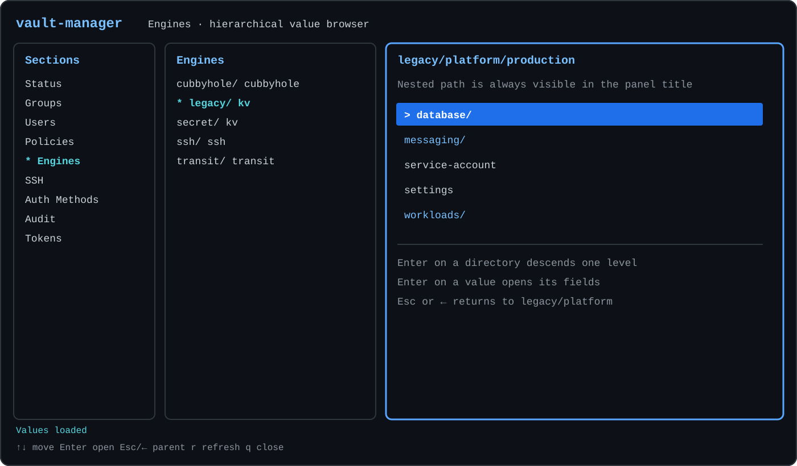
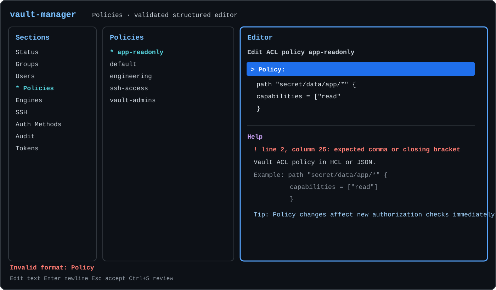

# vault-manager

[English](README.md) · [Русский](README.ru.md) · [Español](README.es.md) ·
[简体中文](README.zh-CN.md)

## Contenido

- [Funcionalidad actual](#funcionalidad-actual)
- [Instalación](#instalación)
- [Compilación](#compilación)
- [Configuración](#configuración)
- [Ejecución](#ejecución)
- [Controles de teclado](#controles-de-teclado)
- [Pertenencia a grupos y seguridad al guardar](#pertenencia-a-grupos-y-seguridad-al-guardar)
- [Comprobaciones de desarrollo](#comprobaciones-de-desarrollo)

**Explorador jerárquico de valores**



**Editor de políticas con validación y ayuda del campo**



`vault-manager` es un gestor de terminal interactivo e independiente para un
clúster de HashiCorp Vault. Se comunica únicamente con la API HTTP de Vault:
no requiere fuentes de identidad externas, sistemas de aprovisionamiento ni
sincronización específica de una instalación.

Versión actual: `0.5`.

Los archivos precompilados y sus sumas de comprobación están disponibles en la
[página de GitHub Releases](https://github.com/shurrman/vault-manager/releases/latest).

La interfaz utiliza tres paneles:

1. secciones como Groups, Users y Engines;
2. elementos de la sección seleccionada;
3. propiedades y acciones del elemento seleccionado.

Los nombres legibles para personas son los identificadores principales. Los
ID y accessors de Vault siguen disponibles en la vista previa cuando resultan
útiles para el diagnóstico.

## Funcionalidad actual

La versión 0.5 gestiona Status, Groups, Users, Policies, Engines, SSH,
Auth Methods, Audit y Tokens:

| Área | Acciones disponibles |
| --- | --- |
| Clúster | Seal, envío de claves unseal, guardado y restauración de snapshots Raft |
| Grupos internos | Crear, editar políticas/pertenencia/metadatos y eliminar |
| Usuarios | Crear userpass, editar entity y contraseña, revocar userpass y eliminar entity |
| Políticas ACL | Crear, editar contenido HCL/JSON multilínea y eliminar |
| Secrets engines | Navegar y leer la jerarquía de valores existente, habilitar y deshabilitar |
| Roles SSH | Crear, editar la configuración JSON completa y eliminar |
| Métodos de autenticación | Ajustar, habilitar y deshabilitar |
| Dispositivos de auditoría | Habilitar y deshabilitar |
| Tokens | Revocar por accessor |

Los valores multilínea conservan saltos e indentación en la vista previa. Cada
editor incluye una zona Help inferior con sintaxis, ejemplos y consejos. Las
acciones destructivas muestran una confirmación con Cancel seleccionado de
forma predeterminada; Vault sigue aplicando las capacidades ACL del token.

Los campos de listas separadas por comas ofrecen opciones filtradas desde los
objetos actuales de Vault; excluyen valores ya seleccionados y permiten elegir
con Arriba/Abajo y `Enter`/`Tab`. Los campos HCL/JSON se validan antes de la
confirmación y otra vez antes de escribir en la API, indicando línea y columna.

El idioma del TUI se define con `ui.language`: `en`, `ru`, `es` o `zh`. Si se
omite, el valor predeterminado es `en`.

## Instalación

Linux y macOS:

```sh
curl -fsSL https://raw.githubusercontent.com/shurrman/vault-manager/main/install.sh | sh
```

Windows PowerShell:

```powershell
irm https://raw.githubusercontent.com/shurrman/vault-manager/main/install.ps1 | iex
```

El instalador selecciona la versión más reciente para el sistema operativo y
la arquitectura actuales y verifica su suma SHA-256 antes de instalarla. En
Linux y macOS usa `/usr/local/bin` si se puede escribir allí; en caso contrario,
usa `~/.local/bin`. En Windows usa `%LOCALAPPDATA%\Programs\vault-manager` y
añade ese directorio al `PATH` del usuario.

## Compilación

Para el desarrollo se necesita Go 1.25 o posterior. La compilación
predeterminada produce un binario Linux amd64 estático para el conjunto básico
de instrucciones x86-64:

```sh
make build
```

El resultado se encuentra en `bin/vault-manager`. La compilación utiliza
`CGO_ENABLED=0` y `GOAMD64=v1` para funcionar desde CentOS 7 hasta
Debian 13.

La matriz completa de archivos de la versión se genera con:

```sh
make release
```

| SO | Arquitectura | Archivo |
| --- | --- | --- |
| Linux | amd64 | `vault-manager_0.5_linux_amd64.tar.gz` |
| Linux | arm64 | `vault-manager_0.5_linux_arm64.tar.gz` |
| macOS | amd64 | `vault-manager_0.5_darwin_amd64.tar.gz` |
| macOS | arm64 | `vault-manager_0.5_darwin_arm64.tar.gz` |
| Windows | amd64 | `vault-manager_0.5_windows_amd64.zip` |

Todos los binarios utilizan `CGO_ENABLED=0`; las compilaciones amd64 usan
`GOAMD64=v1` y las arm64 usan el nivel básico `GOARM64=v8.0`.
`dist/checksums.txt` contiene las sumas SHA-256 de los cinco archivos. Al
publicar una etiqueta de dos partes `vX.Y`, GitHub Actions ejecuta las pruebas,
compila esta matriz y crea o actualiza automáticamente la versión en GitHub.

## Configuración

Copie `.vault-manager.example` como `$HOME/.vault-manager`, sustituya la
dirección y el token, y limite el acceso al propietario del archivo:

```sh
cp .vault-manager.example "$HOME/.vault-manager"
chmod 600 "$HOME/.vault-manager"
```

```toml
[vault]
address = "http://vault.wsoft:8400"
token = "replace-me"
request_timeout = "10s"

[ui]
color = "auto"
language = "es"
```

`ui.language` acepta los códigos de dos letras `en`, `ru`, `es` y `zh`; el
valor predeterminado es `en`. Se admite HTTP sin TLS en redes internas de
confianza con proxy inverso, por ejemplo `http://vault.wsoft:8400`.

Sin `--config`, la aplicación carga `$HOME/.vault-manager` sin depender del
directorio de trabajo actual. La configuración se rechaza si el grupo u otros
usuarios pueden leerla. Tanto `.vault-manager` como `.env` están excluidos de
Git.

Si el archivo no existe y la aplicación se ejecuta en un terminal interactivo,
el diálogo inicial permite seleccionar con el teclado `en`, `ru`, `es` o `zh`,
y después solicita la URL de Vault y un token oculto. Tras validar todos los
valores, crea la ruta elegida como un archivo nuevo con permisos `0600`; nunca
sobrescribe un archivo que aparezca simultáneamente. Si una configuración
existente omite la URL o el token, el diálogo solicita solo los valores que
faltan y los usa durante la ejecución actual sin reescribir el archivo. Las
ejecuciones no interactivas requieren una configuración completa.

Al iniciar, el token configurado se verifica mediante
`auth/token/lookup-self`. Un error de autenticación abre automáticamente el
diálogo de inicio de sesión; la tecla `l` lo abre en cualquier otro momento.
La URL de Vault se puede editar y el método se elige entre `userpass` y
`token`. Userpass usa el montaje estándar `auth/userpass/` y obtiene un nuevo
token de Vault con el usuario y la contraseña introducidos. Tras un inicio
correcto, la URL y el token verificados se escriben atómicamente en la
configuración accesible solo por el propietario, y el usuario o display name
del token aparece en la cabecera. La contraseña nunca se guarda. Al guardar
las credenciales se normaliza el TOML, por lo que no se conservan comentarios
ni formato personalizado.

Una instalación que sincronice la pertenencia a grupos desde otro sistema
puede añadir un aviso local sin modificar la aplicación:

```toml
[deployment]
membership_notice = "Membership is managed externally and may change after synchronization."
```

Este texto se muestra antes de editar los grupos de un usuario. Es únicamente
informativo: el núcleo no llama ni interpreta el sistema externo.

## Ejecución

```sh
bin/vault-manager
```

La versión se muestra con `bin/vault-manager --version`. Para utilizar otro
archivo de configuración, indique `--config /path/to/config.toml`.

La comprobación de conectividad de solo lectura es:

```sh
bin/vault-manager --check
```

La comprobación enumera todas las secciones y muestra una vista previa de su
primer elemento. No realiza operaciones de escritura.

## Controles de teclado

- `↑`/`↓`, `Home`, `End`: desplazarse por el panel activo;
- `←`/`→`: desplazarse entre paneles;
- `Tab`/`Shift+Tab`: ir al panel de la derecha o de la izquierda; `Tab`
  desde el panel central selecciona la primera acción de la vista previa;
- `Enter`: activar un elemento, una acción o un campo del editor;
- `l`: abrir el diálogo de inicio de sesión;
- en listas separadas por comas, `↑`/`↓` eligen una sugerencia filtrada y
  `Enter` o `Tab` la inserta;
- en la fila Engines `Path`, `Enter` abre directamente el explorador; dentro,
  `Enter` desciende/abre y `Esc` o `←` vuelve a la ruta superior;
- `Space`: cambiar un campo booleano del editor;
- `Ctrl+S`: revisar la acción actual del editor;
- `Enter` en un campo multilínea: insertar una línea nueva;
- `Esc`: aceptar un campo multilínea o revisar/salir del editor;
- `r`: actualizar los datos activos;
- `?`: mostrar un recordatorio breve de las teclas;
- `q` o `Ctrl+C`: salir cuando no se está editando un campo de texto.

Se utiliza color cuando el terminal lo admite. Con `ui.color = "never"`, la
variable `NO_COLOR` o un terminal sin color, `*` marca la ruta seleccionada
y `>` el elemento activo. El tamaño mínimo del terminal es 80x20.

## Pertenencia a grupos y seguridad al guardar

Vault almacena la pertenencia directa de una entity en los objetos de grupos
internos. Por eso, cambiar el campo Groups de un usuario puede requerir varias
escrituras secuenciales y no es una operación atómica. Antes de escribir,
`vault-manager` comprueba si la entity o cualquiera de los grupos afectados
ha cambiado. Después actualiza los grupos en un orden determinista por nombre
y verifica cada resultado.

Si una escritura posterior falla, las escrituras anteriores que tuvieron éxito
no se revierten. La interfaz informa de las operaciones aplicadas, fallidas y
no intentadas, vuelve a cargar el estado real de Vault y exige abrir una nueva
edición antes de continuar.

Los demás editores también comparan el objeto actual con la versión cargada
originalmente y se niegan a sobrescribir cambios concurrentes. Las contraseñas
y los tokens nunca se muestran completos, se registran ni se incluyen en
mensajes de error.

## Comprobaciones de desarrollo

```sh
make test
make test-race
make vet
```

Las pruebas de escritura de la API utilizan un servidor HTTP de Vault simulado
dentro del proceso. El clúster configurado solo se utiliza mediante la
comprobación explícita de solo lectura `--check`.

Consulte [docs/ARCHITECTURE.md](docs/ARCHITECTURE.md) para conocer los detalles
de diseño (en inglés).
