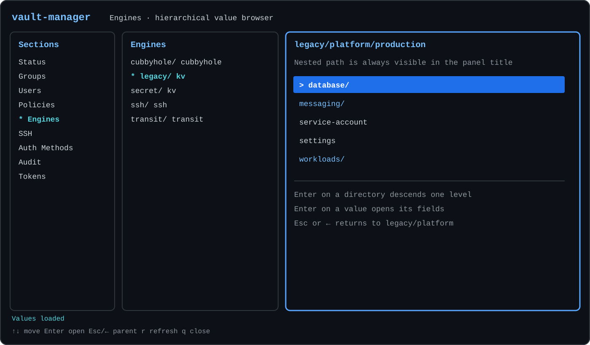

# vault-manager

[English](README.md) · [Русский](README.ru.md) · [Español](README.es.md) ·
[简体中文](README.zh-CN.md)



`vault-manager` is an independent, interactive terminal manager for a
HashiCorp Vault cluster. It talks only to the Vault HTTP API: external identity
sources, provisioning systems, and deployment-specific synchronization are not
required.

Current release: `0.1`.

Prebuilt archives and their checksums are available on the
[GitHub Releases page](https://github.com/shurrman/vault-manager/releases/latest).

The interface uses three panes:

1. sections such as Groups, Users, and Engines;
2. items in the selected section;
3. properties and actions for the selected item.

Human-readable names are primary. Vault IDs and accessors remain visible in
previews when they are useful for diagnostics.

## Current scope

The MVP reads Status, Groups, Users, Policies, Engines, SSH, Auth Methods,
Audit, and Tokens. Existing objects can be changed through these editors:

| Object | Enabled changes |
| --- | --- |
| Internal group | Policies, members, nested groups, metadata |
| Identity entity | Direct policies, internal group membership, disabled state |
| Userpass account | Password |

Create/delete, policy-body editing, engine and KV changes, auth and audit
changes, token revocation, and cluster operations are visible in the UI but
disabled. Disabled controls never call Vault.

## Build

Go 1.25 or newer is required for development. The default build produces a
static Linux amd64 binary using the baseline x86-64 instruction set:

```sh
make build
```

The result is `bin/vault-manager`. The build uses `CGO_ENABLED=0` and
`GOAMD64=v1` for portability from CentOS 7 through Debian 13.

The complete release matrix is produced with:

```sh
make release
```

| OS | Architecture | Archive |
| --- | --- | --- |
| Linux | amd64 | `vault-manager_0.1_linux_amd64.tar.gz` |
| Linux | arm64 | `vault-manager_0.1_linux_arm64.tar.gz` |
| macOS | amd64 | `vault-manager_0.1_darwin_amd64.tar.gz` |
| macOS | arm64 | `vault-manager_0.1_darwin_arm64.tar.gz` |
| Windows | amd64 | `vault-manager_0.1_windows_amd64.zip` |

All binaries use `CGO_ENABLED=0`; amd64 builds use `GOAMD64=v1`, and arm64
builds use the baseline `GOARM64=v8.0`. `dist/checksums.txt` contains SHA-256
checksums for all five archives. Pushing a two-part `vX.Y` tag runs the tests,
builds this matrix, and creates or updates the GitHub Release automatically.

## Configuration

Copy `.vault-manager.example` to `.vault-manager`, replace the address and
token, and restrict the file to its owner:

```sh
cp .vault-manager.example .vault-manager
chmod 600 .vault-manager
```

```toml
[vault]
address = "https://vault.example.com:8200"
token = "replace-me"
request_timeout = "10s"

[ui]
color = "auto"
```

The configuration is rejected if it is readable by group or others. Both
`.vault-manager` and `.env` are excluded from Git.

An installation that synchronizes membership from another system can add a
local warning without changing the application:

```toml
[deployment]
membership_notice = "Membership is managed externally and may change after synchronization."
```

This text is shown before editing user groups. It is informational; the core
does not call or interpret the external system.

## Run

```sh
bin/vault-manager
```

Print the application version with `bin/vault-manager --version`.
Use a different configuration path with `--config /path/to/config.toml`.
The read-only connectivity smoke check is:

```sh
bin/vault-manager --check
```

The check lists every section and previews its first item. It performs no
write operations.

## Keyboard controls

- `↑`/`↓`, `Home`, `End`: move in the active pane;
- `←`/`→`: move between panes;
- `Tab`/`Shift+Tab`: move to the pane on the right/left; `Tab` from the
  middle pane selects the first action in the preview;
- `Enter`: activate an item, action, or editor field;
- `Space`: toggle a boolean editor field;
- `Esc`: leave an editor; dirty drafts open Save / Discard / Cancel;
- `r`: refresh the active data;
- `?`: show a short key reminder;
- `q` or `Ctrl+C`: quit outside text input.

Color is used when supported. With `ui.color = "never"`, `NO_COLOR`, or a
terminal without color, `*` marks the selected path and `>` marks the active
item. The minimum terminal size is 80x20.

## Membership and save safety

Vault stores entity membership on internal group objects. Changing a user's
Groups field can therefore require several sequential writes and is not
atomic. Before writing, `vault-manager` checks the entity and every affected
group for concurrent changes. It then updates groups in deterministic name
order and verifies each result.

If a later write fails, successful earlier writes are not rolled back. The UI
reports applied, failed, and not-attempted operations, reloads the actual Vault
state, and requires a fresh edit before continuing.

All other editors also compare the current object with the version originally
loaded and refuse to overwrite concurrent changes. Passwords and tokens are
never displayed in full, logged, or included in error messages.

## Development checks

```sh
make test
make test-race
make vet
```

API write tests use an in-process fake Vault HTTP server. The configured
cluster is used only by the explicit read-only `--check` command.

See [docs/ARCHITECTURE.md](docs/ARCHITECTURE.md) for design details.
