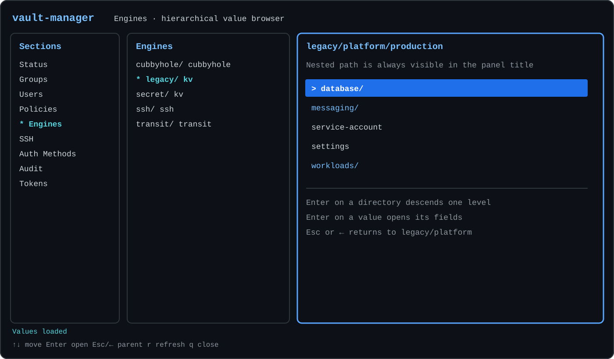

# vault-manager

[English](README.md) · [Русский](README.ru.md) · [Español](README.es.md) ·
[简体中文](README.zh-CN.md)



`vault-manager` — независимый интерактивный терминальный менеджер кластера
HashiCorp Vault. Он взаимодействует только с HTTP API Vault: внешние источники
учётных записей, системы провижининга и специфичная для конкретного окружения
синхронизация не требуются.

Текущий релиз: `0.1`.

Готовые архивы и их контрольные суммы доступны на
[странице GitHub Releases](https://github.com/shurrman/vault-manager/releases/latest).

Интерфейс состоит из трёх панелей:

1. разделы, например Groups, Users и Engines;
2. элементы выбранного раздела;
3. свойства и действия выбранного элемента.

Основными идентификаторами служат понятные человеку имена. ID и accessors Vault
остаются доступны в превью, когда они полезны для диагностики.

## Текущие возможности

Версия 0.1 отображает Status, Groups, Users, Policies, Engines, SSH,
Auth Methods, Audit и Tokens. Существующие объекты можно изменять в следующих
редакторах:

| Объект | Доступные изменения |
| --- | --- |
| Внутренняя группа | Политики, пользователи, вложенные группы, метаданные |
| Identity entity | Прямые политики, членство во внутренних группах, состояние disabled |
| Учётная запись userpass | Пароль |

Создание и удаление объектов, редактирование тела политик, изменение engines и
KV, auth и audit, отзыв токенов и операции с кластером отображаются в
интерфейсе, но отключены. Отключённые элементы управления никогда не вызывают
Vault API.

## Сборка

Для разработки требуется Go 1.25 или новее. Обычная сборка создаёт статический
Linux amd64-бинарник для базового набора инструкций x86-64:

```sh
make build
```

Результат находится в `bin/vault-manager`. Для переносимости от CentOS 7 до
Debian 13 сборка использует `CGO_ENABLED=0` и `GOAMD64=v1`.

Полная матрица релизных архивов создаётся командой:

```sh
make release
```

| ОС | Архитектура | Архив |
| --- | --- | --- |
| Linux | amd64 | `vault-manager_0.1_linux_amd64.tar.gz` |
| Linux | arm64 | `vault-manager_0.1_linux_arm64.tar.gz` |
| macOS | amd64 | `vault-manager_0.1_darwin_amd64.tar.gz` |
| macOS | arm64 | `vault-manager_0.1_darwin_arm64.tar.gz` |
| Windows | amd64 | `vault-manager_0.1_windows_amd64.zip` |

Все бинарники собираются с `CGO_ENABLED=0`; для amd64 используется
`GOAMD64=v1`, а для arm64 — базовый уровень `GOARM64=v8.0`. Файл
`dist/checksums.txt` содержит контрольные суммы SHA-256 всех пяти архивов.
Публикация двухуровневого тега `vX.Y` запускает тесты, собирает эту матрицу и
автоматически создаёт или обновляет GitHub Release.

## Конфигурация

Скопируйте `.vault-manager.example` в `.vault-manager`, замените адрес и
токен и ограничьте доступ к файлу его владельцем:

```sh
cp .vault-manager.example .vault-manager
chmod 600 .vault-manager
```

```toml
[vault]
address = "https://vault.example.com:8200"
token = "replace-me"
request_timeout = "10s"

[ui]
color = "auto"
```

Конфигурация будет отклонена, если она доступна группе или остальным
пользователям. Файлы `.vault-manager` и `.env` исключены из Git.

Если в окружении членство в группах синхронизируется из другой системы, можно
добавить локальное предупреждение без изменения приложения:

```toml
[deployment]
membership_notice = "Membership is managed externally and may change after synchronization."
```

Этот текст показывается перед редактированием групп пользователя. Он носит
информационный характер: ядро приложения не вызывает и не интерпретирует
внешнюю систему.

## Запуск

```sh
bin/vault-manager
```

Версию приложения можно вывести командой
`bin/vault-manager --version`. Другой путь к конфигурации задаётся через
`--config /path/to/config.toml`.

Проверка подключения только для чтения:

```sh
bin/vault-manager --check
```

Проверка перечисляет элементы каждого раздела и загружает превью первого
элемента. Операции записи не выполняются.

## Управление с клавиатуры

- `↑`/`↓`, `Home`, `End`: перемещение в активной панели;
- `←`/`→`: перемещение между панелями;
- `Tab`/`Shift+Tab`: переход на панель справа или слева; `Tab` из средней
  панели выбирает первое действие в превью;
- `Enter`: активация элемента, действия или поля редактора;
- `Space`: переключение логического поля редактора;
- `Esc`: выход из редактора; для изменённого черновика открывается диалог
  Save / Discard / Cancel;
- `r`: обновление активных данных;
- `?`: краткая подсказка по клавишам;
- `q` или `Ctrl+C`: выход вне текстового поля.

Цвет используется, если терминал его поддерживает. При
`ui.color = "never"`, установленной переменной `NO_COLOR` или отсутствии
цвета в терминале символ `*` отмечает выбранную цепочку, а `>` — активный
элемент. Минимальный размер терминала — 80x20.

## Безопасность членства в группах и сохранения

Vault хранит прямое членство entity в объектах внутренних групп. Поэтому
изменение поля Groups пользователя может потребовать нескольких
последовательных операций записи и не является атомарным. Перед записью
`vault-manager` проверяет entity и все затронутые группы на конкурентные
изменения, затем обновляет группы в детерминированном порядке по имени и
проверяет результат каждой операции.

Если одна из последующих операций завершается ошибкой, ранее выполненные
операции не откатываются. Интерфейс перечисляет применённые, неуспешные и ещё
не выполнявшиеся операции, перечитывает фактическое состояние Vault и требует
заново открыть редактор перед продолжением.

Остальные редакторы также сравнивают текущее состояние объекта с первоначально
загруженной версией и отказываются перезаписывать конкурентные изменения.
Пароли и токены никогда не показываются полностью, не журналируются и не
включаются в сообщения об ошибках.

## Проверки при разработке

```sh
make test
make test-race
make vet
```

Тесты операций записи используют встроенный fake HTTP-сервер Vault.
Настроенный кластер используется только явной проверкой `--check` в режиме
чтения.

Подробности архитектуры приведены в
[docs/ARCHITECTURE.md](docs/ARCHITECTURE.md) (на английском).
