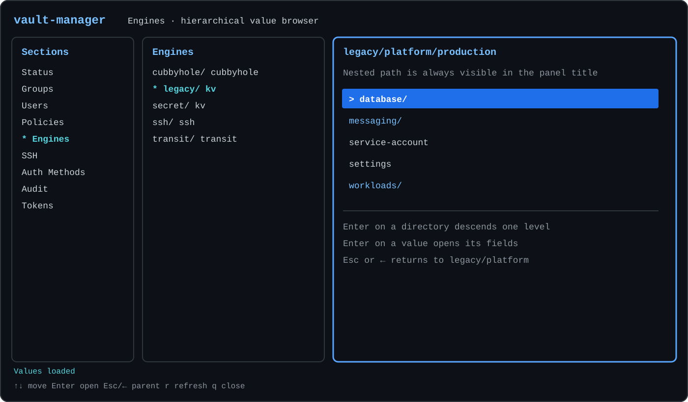

# vault-manager

[English](README.md) · [Русский](README.ru.md) · [Español](README.es.md) ·
[简体中文](README.zh-CN.md)



`vault-manager` 是一个独立的 HashiCorp Vault 集群交互式终端管理器。它只与
Vault HTTP API 通信，不依赖外部身份源、配置系统或特定部署环境的同步机制。

当前版本：`0.1`。

预构建归档及其校验和可从
[GitHub Releases 页面](https://github.com/shurrman/vault-manager/releases/latest)下载。

界面由三个面板组成：

1. Groups、Users、Engines 等功能分区；
2. 当前分区中的项目；
3. 当前项目的属性与操作。

界面优先显示易于理解的名称。Vault ID 和 accessor 仍会在有助于诊断时显示在
预览中。

## 当前功能

版本 0.1 可查看 Status、Groups、Users、Policies、Engines、SSH、
Auth Methods、Audit 和 Tokens。可以通过以下编辑器修改现有对象：

| 对象 | 可修改内容 |
| --- | --- |
| 内部组 | 策略、成员、嵌套组、元数据 |
| Identity entity | 直接策略、内部组成员关系、disabled 状态 |
| userpass 账户 | 密码 |

创建和删除对象、编辑策略正文、修改 engine 和 KV、修改 auth 和 audit、吊销
token，以及集群操作均会显示在界面中，但目前处于禁用状态。禁用的控件不会调用
Vault API。

## 构建

开发需要 Go 1.25 或更高版本。默认构建会生成使用基础 x86-64 指令集的静态
Linux amd64 二进制文件：

```sh
make build
```

构建结果位于 `bin/vault-manager`。构建使用 `CGO_ENABLED=0` 和
`GOAMD64=v1`，以兼容从 CentOS 7 到 Debian 13 的系统。

使用以下命令生成完整的发布归档矩阵：

```sh
make release
```

| 操作系统 | 架构 | 归档 |
| --- | --- | --- |
| Linux | amd64 | `vault-manager_0.1_linux_amd64.tar.gz` |
| Linux | arm64 | `vault-manager_0.1_linux_arm64.tar.gz` |
| macOS | amd64 | `vault-manager_0.1_darwin_amd64.tar.gz` |
| macOS | arm64 | `vault-manager_0.1_darwin_arm64.tar.gz` |
| Windows | amd64 | `vault-manager_0.1_windows_amd64.zip` |

所有二进制文件均使用 `CGO_ENABLED=0` 构建；amd64 构建使用
`GOAMD64=v1`，arm64 构建使用基础级别 `GOARM64=v8.0`。
`dist/checksums.txt` 包含五个归档的 SHA-256 校验和。推送两段式 `vX.Y`
标签后，GitHub Actions 会运行测试、构建此矩阵并自动创建或更新 GitHub Release。

## 配置

将 `.vault-manager.example` 复制为 `.vault-manager`，替换 Vault 地址和
token，并将文件权限限制为仅所有者可访问：

```sh
cp .vault-manager.example .vault-manager
chmod 600 .vault-manager
```

```toml
[vault]
address = "https://vault.example.com:8200"
token = "replace-me"
request_timeout = "10s"

[ui]
color = "auto"
```

如果组用户或其他用户可以读取配置文件，程序将拒绝使用该文件。
`.vault-manager` 和 `.env` 均已被 Git 忽略。

如果某个部署环境从其他系统同步组成员关系，可以在不修改应用程序的情况下添加
本地提示：

```toml
[deployment]
membership_notice = "Membership is managed externally and may change after synchronization."
```

这段文字会在编辑用户组之前显示。它仅用于提示；程序核心不会调用或解析外部系统。

## 运行

```sh
bin/vault-manager
```

使用 `bin/vault-manager --version` 显示应用版本。使用
`--config /path/to/config.toml` 指定其他配置文件。

只读连接检查命令：

```sh
bin/vault-manager --check
```

该检查会列出每个分区，并加载其中第一个项目的预览，不执行任何写操作。

## 键盘操作

- `↑`/`↓`、`Home`、`End`：在当前面板中移动；
- `←`/`→`：在面板之间移动；
- `Tab`/`Shift+Tab`：切换到右侧或左侧面板；在中间面板按 `Tab` 会选中
  预览中的第一个操作；
- `Enter`：激活项目、操作或编辑器字段；
- `Space`：切换编辑器中的布尔字段；
- `Esc`：退出编辑器；如果草稿已修改，则显示 Save / Discard / Cancel
  对话框；
- `r`：刷新当前数据；
- `?`：显示简短的按键提示；
- `q` 或 `Ctrl+C`：未编辑文本字段时退出。

终端支持时会使用颜色。设置 `ui.color = "never"`、存在 `NO_COLOR` 环境变量
或终端不支持颜色时，`*` 表示选中的路径，`>` 表示当前活动项目。终端最小
尺寸为 80x20。

## 成员关系与保存安全

Vault 将 entity 的直接成员关系存储在内部组对象中。因此，修改用户的 Groups
字段可能需要多次顺序写入，这一过程不是原子操作。写入前，`vault-manager`
会检查 entity 和所有受影响的组是否发生并发更改，然后按组名的确定顺序更新各组，
并验证每次更新的结果。

如果后续写入失败，之前成功的写入不会回滚。界面会列出已应用、失败和未尝试的
操作，重新加载 Vault 的实际状态，并要求重新打开编辑器后再继续。

其他编辑器同样会将对象的当前状态与最初加载的版本进行比较，并拒绝覆盖并发更改。
密码和 token 不会完整显示、写入日志或包含在错误消息中。

## 开发检查

```sh
make test
make test-race
make vet
```

API 写入测试使用进程内的模拟 Vault HTTP 服务器。配置的集群只会由显式的只读
`--check` 命令访问。

设计详情请参阅 [docs/ARCHITECTURE.md](docs/ARCHITECTURE.md)（英文）。
